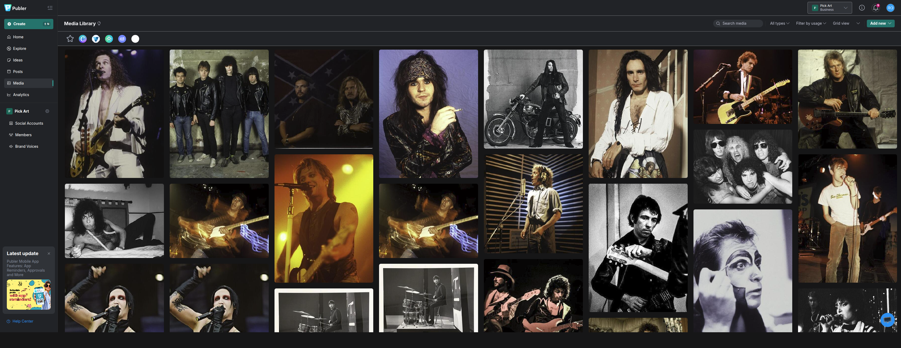

# PickArt Media Bible

**A practical system for turning music stories into social posts.**

PickArt sells high-end, limited-edition music photography. I suggested to the gallery and website's owner that engaging with social media could promote the business, attract visitors and encourage trade. The owner offered me a role managing PickArt's social media. I didn't have time to take on the ongoing role, so I proposed a different solution: build a social-media robot that could post on PickArt's behalf and share interesting material for different audiences.

I wanted the posts to do more than keep a schedule. Each should have a timely or audience-relevant reason to feature an artist and connect their story with the prints. I designed and built a cloud publishing system around that idea. It remains operational.

## Examples of the editorial approach

These published posts show two different angles: an anniversary-led story and a biographical detail.

| Anniversary-led story | Biographical and creative angle |
| --- | --- |
|  |  |
| The date gives the Bat Out of Hell post its timely hook. | The post pairs Collins's Genesis story with a detail about his songwriting process. |

## How selection works

The system checks the event calendar first. Events can include an artist's birthday, date of death, first album release, first hit single or another anniversary. A matching event guides the choice of artist and related content. If no event matches, a carousel fallback chooses an eligible artist and uses evergreen content linked to them.

| Route | Content selected |
| --- | --- |
| Matching event | Related event-led artist content |
| No matching event | Evergreen content linked to an eligible artist |

To make posts interesting to more than one kind of reader, I built artist-linked content libraries around three sets of interests:

| Audience | Material | Why it matters |
| --- | --- | --- |
| Vinyl collectors, audiophiles and recording enthusiasts | Recording and mixing techniques, mixing desks, microphones, instruments, how songs were made and unusual vinyl pressings | Adds depth and knowledge to the story behind an artist and print. |
| Music fans | Unusual or amusing artist and band factoids, interactions and biography | Gives each post a memorable human story. |
| People choosing fine art for their homes | Interior and décor ideas, plus the story behind a photograph | Makes a print a distinctive conversation piece the owner can talk about—not just something to match a wall. |

  

*PickArt's media library in Publer.*

  

The carousel favours less-used eligible artists and checks recent and same-day selections to keep posts varied.

Python programs run on Google Cloud Run and draw on an image library, an event calendar and linked CSV content files. Both selection routes lead to publishing through Publer, which passes posts to Facebook and Instagram. I designed the content structure, event and fallback rules, audience-aware editorial approach, cloud integration and practical operation.

## Operating record

Since regular publishing began in **May 2026**, the robot has published **1,288 posts** (as of 4 November 2026). It has experienced **zero failures**.

## The wider PickArt project

Once the robot was posting regularly, early interaction remained limited because the social accounts had few followers. I also felt that, although the existing site looked like a competent ecommerce shop, it did not convey what made each high-end print distinctive. The owner was initially unsure about a redesign.

To test how the existing shop responded to paid traffic, I proposed a one-month exploratory Meta campaign with an agreed **£250 budget**. The campaign tested the existing shop, not a deployed redesign. I created Beatles-focused adverts around the group's December 1963 appearance on *Thank Your Lucky Stars*, before their US breakthrough.

A captured reporting window of **13 September–31 October 2026** shows 216,692 Meta accounts reached, 404,585 impressions, 21,895 link clicks and 12,319 recorded landing-page views. The owner reported some attempted purchases but little to no sales uplift. Follow-up checks revealed outdated or broken ecommerce components.

The experiment helped persuade the owner to proceed with a website redesign. The proposed redesign experience shows the direction. The next phase is redesign work alongside another Meta campaign. I also observed delivery concentrating on early-performing adverts, while some creative received little exposure. For the next experiment, I plan to separate creative tests more deliberately and compare the ideas rather than assume each advert receives equal exposure.

*The implementation remains private. Screenshots are included as evidence for this case study, not with permission to reuse them. The photography and prints are not claimed as my work.*
