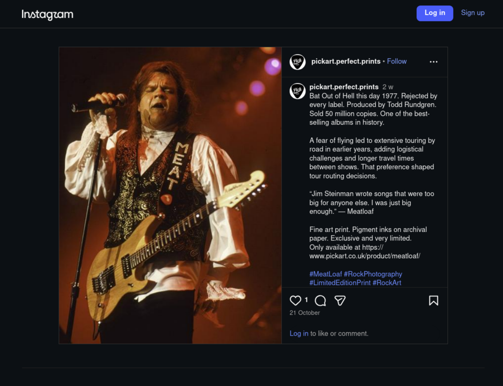
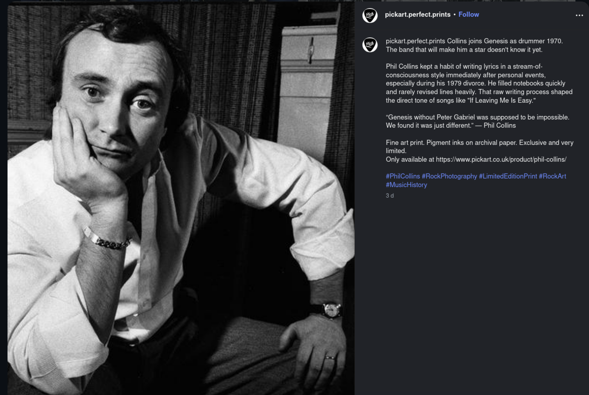
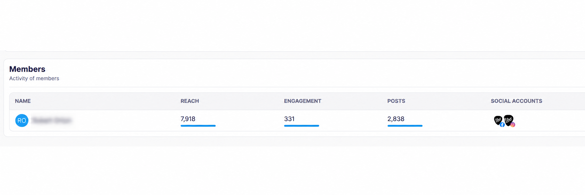
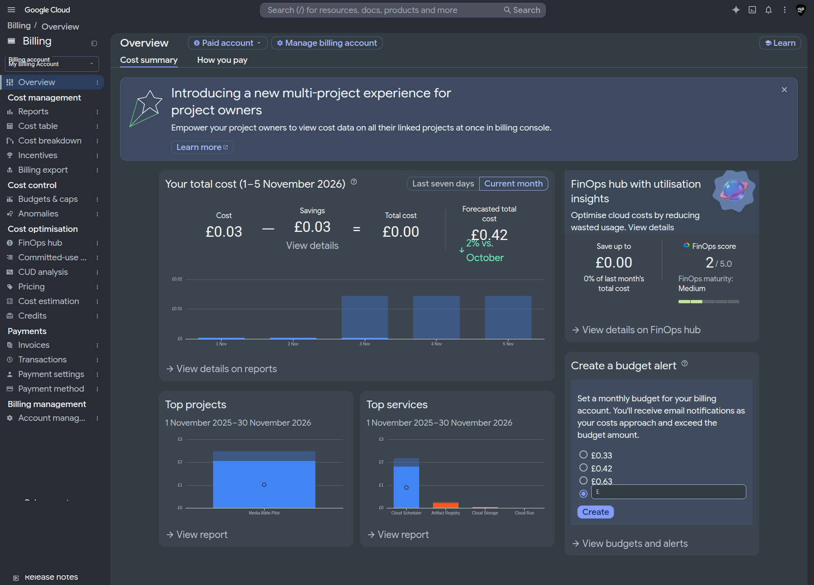
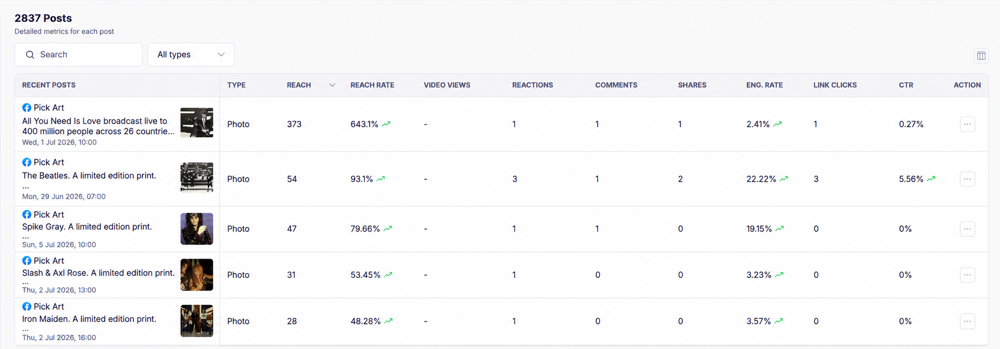

# PickArt Media Bible

**A practical system for turning music stories into social posts.**

PickArt sells high-end, limited-edition music photography. I suggested to the gallery and website's owner that engaging with social media could promote the business, attract visitors and encourage trade. The owner offered me a role managing PickArt's social media. I didn't have time to take on the ongoing role, so I proposed a different solution: build a social-media robot that could post on PickArt's behalf and share interesting material for different audiences.

I wanted the posts to do more than keep a schedule. Each should have a timely or audience-relevant reason to feature an artist and connect their story with the prints. I designed and built a cloud publishing system around that idea. It remains operational.

## Examples of the editorial approach

These published posts show two different angles: an anniversary-led story and a biographical detail.

| Anniversary-led story | Biographical and creative angle |
| --- | --- |
|  |  |
| The date gives the Bat Out of Hell post its timely hook. | The post pairs Collins's Genesis story with a detail about his songwriting process. |

## How selection works

The system checks the event calendar first. Events can include an artist's birthday, date of death, first album release, first hit single or another anniversary. A matching event guides the choice of artist and related content. If no event matches, a carousel fallback chooses an eligible artist and uses evergreen content linked to them.

| Route | Content selected |
| --- | --- |
| Matching event | Related event-led artist content |
| No matching event | Evergreen content linked to an eligible artist |

To make posts interesting to more than one kind of reader, I built artist-linked content libraries around three sets of interests:

| Audience | Material | Why it matters |
| --- | --- | --- |
| Vinyl collectors, audiophiles and recording enthusiasts | Recording and mixing techniques, mixing desks, microphones, instruments, how songs were made and unusual vinyl pressings | Adds depth and knowledge to the story behind an artist and print. |
| Music fans | Unusual or amusing artist and band factoids, interactions and biography | Gives each post a memorable human story. |
| People choosing fine art for their homes | Interior and décor ideas, plus the story behind a photograph | Makes a print a distinctive conversation piece the owner can talk about—not just something to match a wall. |

 

*PickArt's media library in Publer.*

 

The carousel favours less-used eligible artists and checks recent and same-day selections to keep posts varied.

Python programs run on Google Cloud Run and draw on an image library, an event calendar and linked CSV content files. Both selection routes lead to publishing through Publer, which passes posts to Facebook and Instagram. I designed the content structure, event and fallback rules, audience-aware editorial approach, cloud integration and practical operation.

## Operating record

Since regular publishing began in **May 2026**, the robot has published **2,838 posts** across PickArt's Facebook and Instagram accounts, with **zero recorded failures**. Publer's member overview records reach of **7,918** and **331 engagements**. A separate account overview shows **335K reach** and follower growth from **1 to 111**—a gain of **110 followers, an 11,000% increase**.

 

*Publer member overview captured on 5 November 2026.*

 

## Operating cost

I promised the client that the robot would be inexpensive to run. I created a dedicated Google identity and Google Cloud account for the project, which provided a **$300 promotional credit**. The credit expired unused. Since May 2026, Google Cloud charges for the project have totalled just over **£1**.

On **5 November 2026**, Google Cloud forecast **£0.42** for November. At the current level of activity, that suggests a running cost of roughly **40–45p per month**. The client was delighted, especially compared with the much higher monthly fees quoted by other providers for ongoing social media work.

*Google Cloud Billing snapshot captured on 5 November 2026: £0.03 in month-to-date costs, offset by £0.03 in savings, with a £0.42 forecast for November.*

## The wider PickArt project

Once the robot was posting regularly, early interaction remained limited because the social accounts had few followers. I also felt that, although the existing site looked like a competent ecommerce shop, it did not convey what made each high-end print distinctive. The owner was initially unsure about a redesign.

The robot's post insights helped shape that decision. A Beatles post about *All You Need Is Love* recorded a **643.1% reach rate**, while another Beatles post recorded **93.1%**. The response prompted me to propose a one-month exploratory Meta campaign with an agreed **£250 budget**, focused on PickArt's December 1963 Beatles archive. The campaign used the Paul McCartney event photograph from the group's appearance on *Thank Your Lucky Stars* and tested the existing shop, not a deployed redesign.

 

*The first five entries in Publer's post insights, including the Beatles “All You Need Is Love” post at a 643.1% reach rate.*

 

*The implementation remains private. Screenshots are included as evidence for this case study, not with permission to reuse them. The photography and prints are not claimed as my work.*

[Next: the Meta advertising campaign](../02-meta-ad-campaign/README.md)
