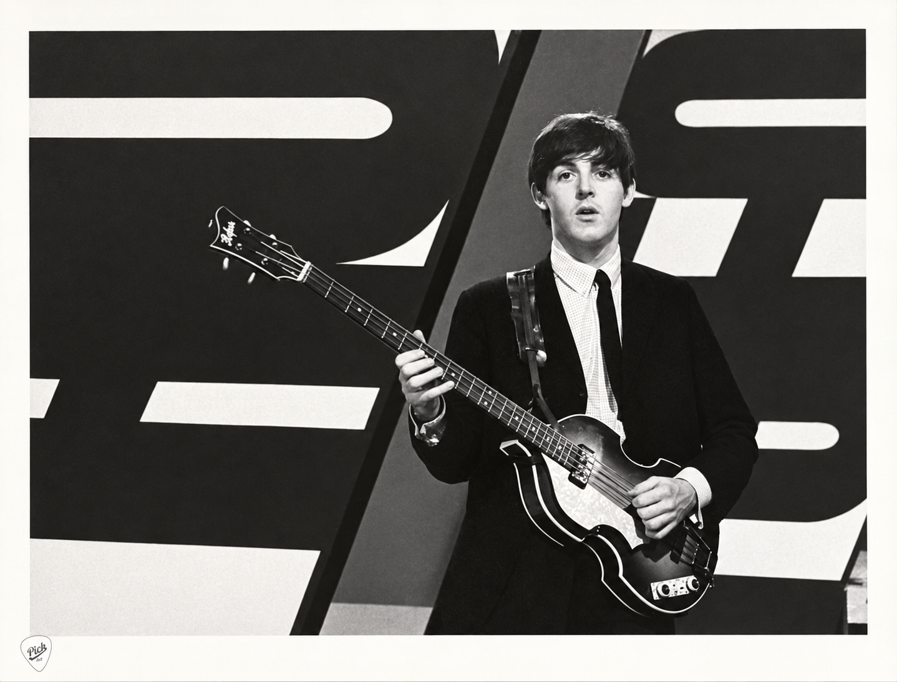
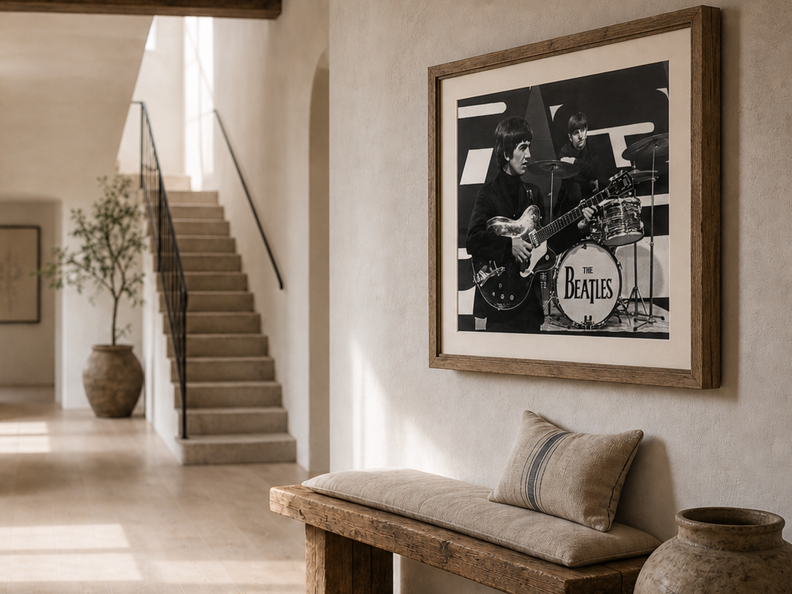
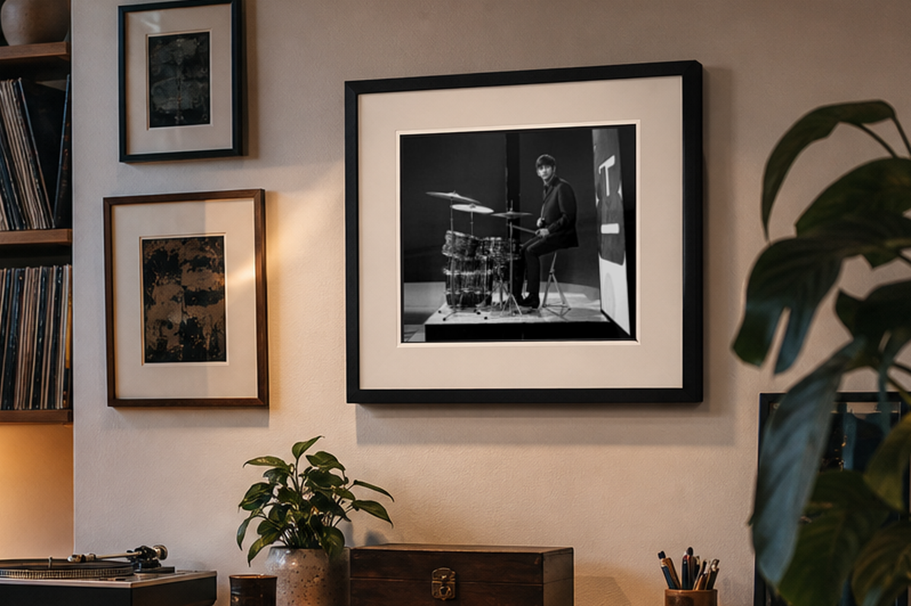
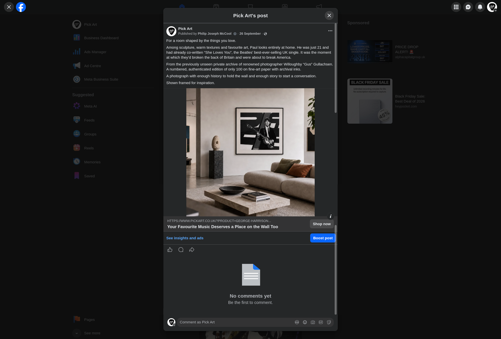
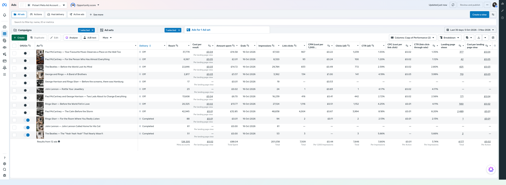

# 02 — Meta ad campaign

## The question and the offer

I wanted to test a practical question: could story-led Beatles advertising bring interested people to PickArt's existing shop? I proposed a one-month Meta campaign with a **£250 limit** and developed 12 ads in two visual formats. The focus was the owner's exclusive archive of photographs by local photographer Willoughby “Gus” Gullachsen. The prints were offered as numbered, limited-edition ways to own a moment of music history, not as generic band merchandise.

One format presented the historical photograph directly. The other showed the same archival material as an imagined framed print in an aspirational room. Both made the story part of the value: a print could be something its owner enjoyed looking at and telling people about.

## Own a moment of music history

The campaign drew on the Beatles' appearance on *Thank Your Lucky Stars*, recorded at Alpha/ATV's Birmingham studios on 15 December 1963. The Merseybeat Special featured four tracks, closing with “She Loves You”, while the band's US breakthrough was still ahead. The group were **appearing live in the studio**—a specific moment behind the print, rather than a generic Beatles image.

The Paul McCartney event photograph shows the direct format. Its story links the image to the young band on the edge of an international breakthrough; the ad directed interested visitors to the corresponding Paul McCartney product page.

## Imagine the print at home

The framed-room images offered another reason to value the same archive: they helped a prospective buyer imagine how a print might sit in a home and reflect personal taste. I thought about several distinct, related interests when shaping stories for these ads:

- **Art and interiors:** a distinctive image, its visual presence and the story an owner could share. The oak-framed George and Ringo hallway is one example.
- **Vinyl and hi-fi:** records, valve amplifiers and listening systems. Ringo in the listening room connects the print to that environment.
- **Recording equipment:** microphones, mixing desks, instruments and recording techniques—a narrower interest, not simply another name for collecting records.

I used these interests to shape the stories accompanying the prints. Unusual pressings, recording methods and equipment could connect a photograph with a reader’s own passion for music.

| Event photograph | Framed-print hallway | Listening-room setting |
| --- | --- | --- |
|  |  |  |
| The historical moment itself. | A print as part of a distinctive home. | A print in a vinyl and hi-fi setting. |

## An assembled advert

The complete Facebook post capture shows the storytelling approach in context: copy, framed-room image, headline and “Shop now” action appear together. Provenance and limited-edition value support the appeal of the print rather than interrupting the story.

*Complete Facebook post capture: copy, room image, headline and “Shop now” action.*

[View the George-and-Ringo sponsored desktop-feed preview](assets/george-and-ringo-ad-preview.png).

## Delivery and results

The campaign objective was Traffic to the website, optimised for landing-page views. I repeatedly paused dominant adverts when they absorbed most of the delivery, because the other creatives were receiving too little spend to give me useful feedback. In a dated 21 September review, two ads accounted for about **98.6% of spend in that selected period**; I paused them so the remaining ten could receive delivery. This was a practical intervention, not an equal-exposure comparison of all 12 ads. For a future test, I would structure creative comparisons more deliberately.

The Meta results capture covers **5 October–3 November 2026**. These figures describe that reporting window, not a campaign-lifetime total.

| Accounts reached | Impressions | Website link clicks |
| ---: | ---: | ---: |
| **126,205** | **201,038** | **7,509** |

| Clicks (all) | CTR (all) | Recorded landing-page views |
| ---: | ---: | ---: |
| **7,646** | **3.80%** | **4,177** |

| Agreed campaign budget | Recorded spend in window | Cost per landing-page view |
| ---: | ---: | ---: |
| **£250** | **£88.04** | **£0.02** |

“Clicks (all)” includes activity beyond website link clicks; a landing-page view is Meta's recorded page-arrival measure. The 2p cost is rounded to the displayed precision.

*Reporting-window results capture.*

The campaign brought substantial attention and traffic, but the owner reported that sales remained flat. That met the condition of the wager I had proposed: interest increased without a corresponding rise in sales, and the owner accepted the case for changing the website. The results made the buying journey the next business question; the campaign itself did not test a redesigned site.

[Back to the PickArt project overview](../README.md).
