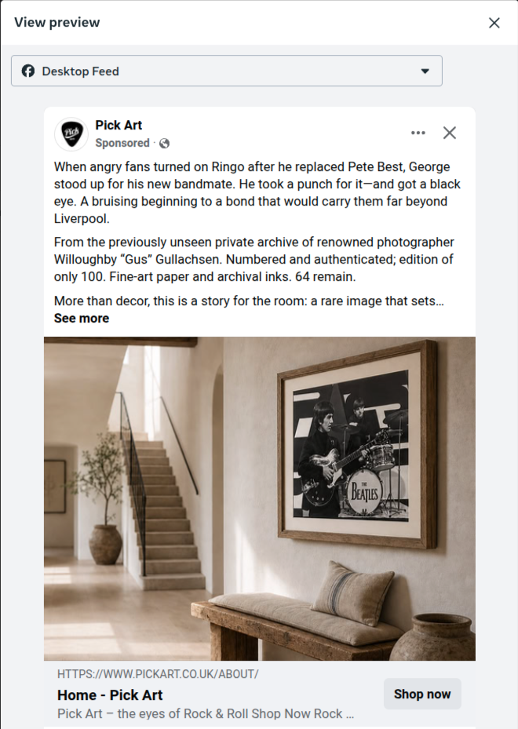

# 02 — Meta ad campaign

## The question

The publishing robot was working, but PickArt's social accounts were still small. I also felt the existing website, while it looked like a competent ecommerce shop, did not yet communicate the distinctive stories and archival value behind its high-end prints. The owner was unsure about a redesign. Rather than ask for a larger commitment on instinct, I proposed a bounded experiment: use Beatles storytelling to bring people to the shop as it already existed and learn from the journey.

We agreed a **£250 budget** for a one-month exploratory Meta Ads campaign. The ads centred on the Beatles' December 1963 appearance on *Thank Your Lucky Stars*, before their US breakthrough. I hand-crafted the copy around the moment and its wider story, then used framed-in-room mock-ups to help connect the archive to a prospective buyer's home. The campaign copy credits the photographs to Willoughby “Gus” Gullachsen.

## Results snapshot

The figures below are the Meta reporting snapshot for **5 October–3 November 2026**. Each cell is a separate measure from that window.

| Accounts reached | Impressions | Website link clicks |
| ---: | ---: | ---: |
| **126,205** | **201,038** | **7,509** |

| Clicks (all) | CTR (all) | Recorded landing-page views |
| ---: | ---: | ---: |
| **7,646** | **3.80%** | **4,177** |

| Agreed campaign budget | Recorded spend in window | Cost per landing-page view |
| ---: | ---: | ---: |
| **£250** | **£88.04** | **£0.02** |

“Clicks (all)” includes activity beyond website link clicks; “landing-page views” is Meta's recorded page-arrival measure. The 2p cost is rounded to the displayed precision. The screenshot records the selected reporting window, not the complete campaign lifetime.

*Reporting-window results capture; the figures above are transcribed from this view.*

## The creative and the journey

The campaign let me bring the storytelling approach into paid creative. One Facebook post framed Paul McCartney's early Beatles story around “She Loves You” and a print shown in a room. Another sponsored desktop preview used the George-and-Ringo story of their friendship and placed the print in a home setting.

*Facebook post capture showing the Paul McCartney creative and framed-room mock-up.*

*Sponsored desktop-feed preview of the George-and-Ringo creative.*

The ads brought visitors to the existing shop, but the owner reported attempted purchases with little to no sales uplift. Follow-up investigation found outdated or broken ecommerce components. The experiment helped make the case for improving the buying journey, rather than simply sending more traffic to it.

The campaign tested the original shop, not the proposed redesign. A further Meta campaign is planned alongside redesign work. The next phase is the redesign experience that grew out of this work: [03 — Website redesign](../03-website-redesign/README.md).

One campaign lesson was about how delivery unfolded. Early-performing creative received much of the exposure, while some alternatives had little opportunity to be compared. For a future experiment, I plan to separate creative tests more deliberately so the comparison answers a clearer question.
