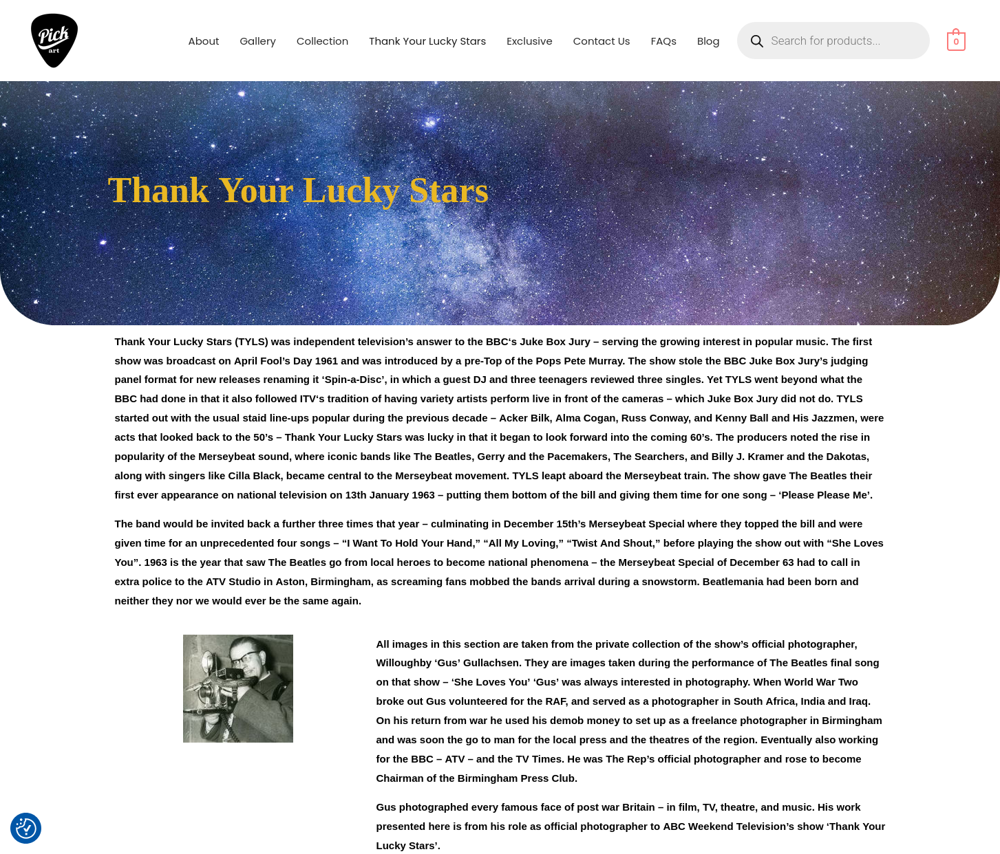
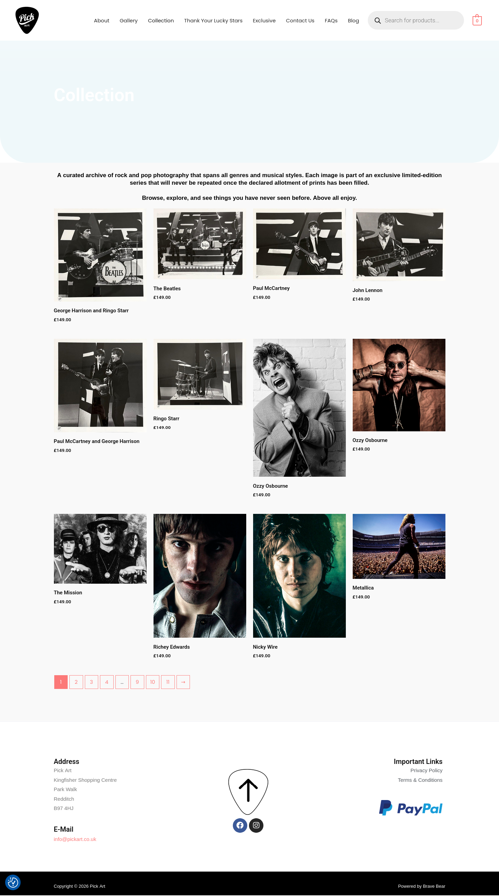
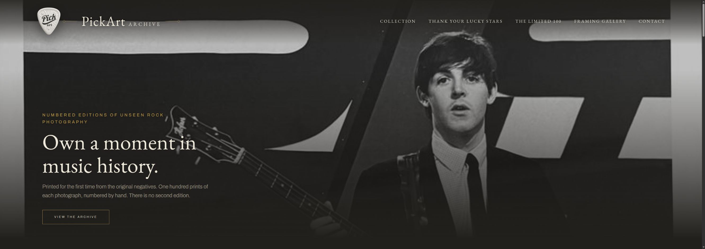
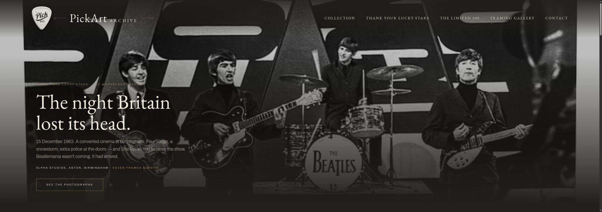
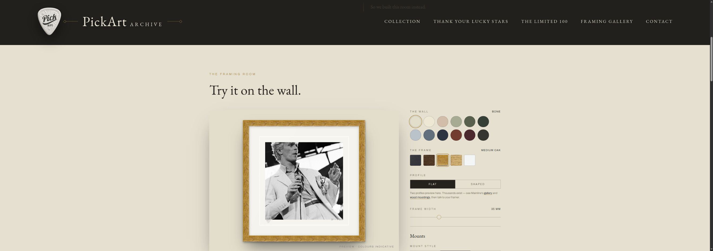

# 03 — Website redesign: from catalogue to collection

I believed PickArt’s website was presenting rare music photographs as ordinary products. The owner felt the existing shop was good enough. Rather than keep arguing, I proposed a one-month Meta experiment with a £250 limit and offered to put my own money behind the diagnosis. If traffic rose without sales rising in a similar proportion, he would agree to a complete redesign; if both rose in line, I would refund the advertising cost; if traffic did not rise, I would cover the campaign cost. We agreed on 12 owner-reviewed ads.

The campaign focused on PickArt’s exclusive Beatles archive around the group’s 15 December 1963 appearance on *Thank Your Lucky Stars*. The existing shop—not the proposed redesign—was the destination. [See the campaign experiment and its evidence](../02-meta-ad-campaign/README.md).

## What the campaign showed

Meta recorded substantial reach and thousands of landing-page views during this reporting window:

| Measure | Reported result |
| --- | ---: |
| Reporting window | 13 September–31 October 2026 |
| Agreed campaign budget | £250 |
| Spend recorded in the window | £244.97 |
| Accounts reached | 216,692 |
| Impressions | 404,585 |
| Website link clicks | 21,895 |
| Recorded landing-page views | 12,319 |

The owner later reported little or no sales uplift. Link clicks are not unique visitors or purchases; landing-page views are Meta’s recorded page-arrival measure. The figures gave me a reason to examine the buying experience, not proof that attention alone guarantees a sale.

**We attracted the interest. Why wasn’t the website closing sales?**

Follow-up checks also highlighted outdated or broken ecommerce components. That was a separate practical barrier: a stronger presentation could not repair an unreliable checkout.

## First, the existing site

I wrote the existing *Thank Your Lucky Stars* copy and the print stories, supplying them to the owner and developer as text. I did not design or control the existing page layouts. The issue was how the material was presented—not an absence of story or provenance.

### Homepage: a camera before the collection

The opening leads with a generic camera image and the broad invitation “the eyes of Rock & Roll”. It establishes a category, but the first image is not one of PickArt’s exclusive photographs for sale. A visitor has to infer why this particular archive—and a premium print from it—is worth owning.

### Thank Your Lucky Stars: a rich story in a dense presentation

The page contains substantial history and photographer information. Its star-field banner and long, uniformly bold blocks give the reader few visual pauses, so the Birmingham event, its significance and the collection’s provenance are harder to distinguish at a glance. The story is there; the hierarchy does not help a buyer find its most compelling details.

### Collection: product imagery carries quality signals

The catalogue presents products and prices competently, but photographs of prints through glass show reflections, banding and a phone or photographer silhouette across the Paul McCartney image. Those distractions compete with the photograph and weaken the premium impression a £149 print needs to earn.

## The diagnosis

The site listed products, but did not yet help a visitor value a particular moment in music history. The redesign needed photography with impact, a clear story and provenance, coherent quality signals, and a way for a buyer to imagine living with the print. The reported checkout problems remained separate technical work.

## The proposed experience

### Homepage: let the photograph lead

The working homepage opens with the photograph itself, then connects it to numbered editions, provenance and the wider archive. A clear headline and restrained visual system give the image room and make its context easier to follow. The intended buyer benefit is simple: see what the collection offers, understand why it is distinctive, and begin to imagine owning a print.

I reprocessed many of the presentation images to remove the reflections and banding visible in the existing shop. Charcoal, cream and muted gold with editorial typography are intended to suggest a considered gallery rather than a generic catalogue; prominent edition and provenance details give buyers concrete reasons to value a print.

### Thank Your Lucky Stars: make one moment legible

The next page gives the photographs a specific entry point: the Beatles performing “She Loves You” at the Merseybeat Special in Birmingham on 15 December 1963. It connects the event and its context to the official photographer, Willoughby “Gus” Gullachsen, and his private archive. The design aims to help a fan recognise why these frames matter and what makes the collection distinctive.

These are intended design responses, not measured conversion effects.

## A separate customer problem: framing

Glass can break in courier transit and damage the print it is meant to protect. Frame choices are personal too: the right combination depends on a buyer’s room, wall and taste. I turned those constraints into a positive policy: **“We don’t frame. Deliberately.”**

The framing tool is a separate way to help someone picture a print at home. It brings together print selection, wall and frame choices, profiles, widths and mount options, then offers a printable Framer’s Brief to take to a local framer. The work of choosing a frame remains with the buyer and their framer.

## Three working proposal pages

These are three owner-facing prototype pages; other navigation destinations are outside the preview. This is not a launched replacement shop. The proposal makes the intended buying experience tangible and discussable before production.

| Page | Open the working proposal |
| --- | --- |
| Homepage | [PickArt Archive homepage](https://tidyweb.github.io/pickart-web-redesign/pickart_home.html) |
| Thank Your Lucky Stars | [TYLS collection page](https://tidyweb.github.io/pickart-web-redesign/pickart_tyls.html) |
| Framing Gallery | [Framing tool](https://tidyweb.github.io/pickart-web-redesign/pickart_framing.html) |

This work sits within the wider [PickArt project](../README.md).
