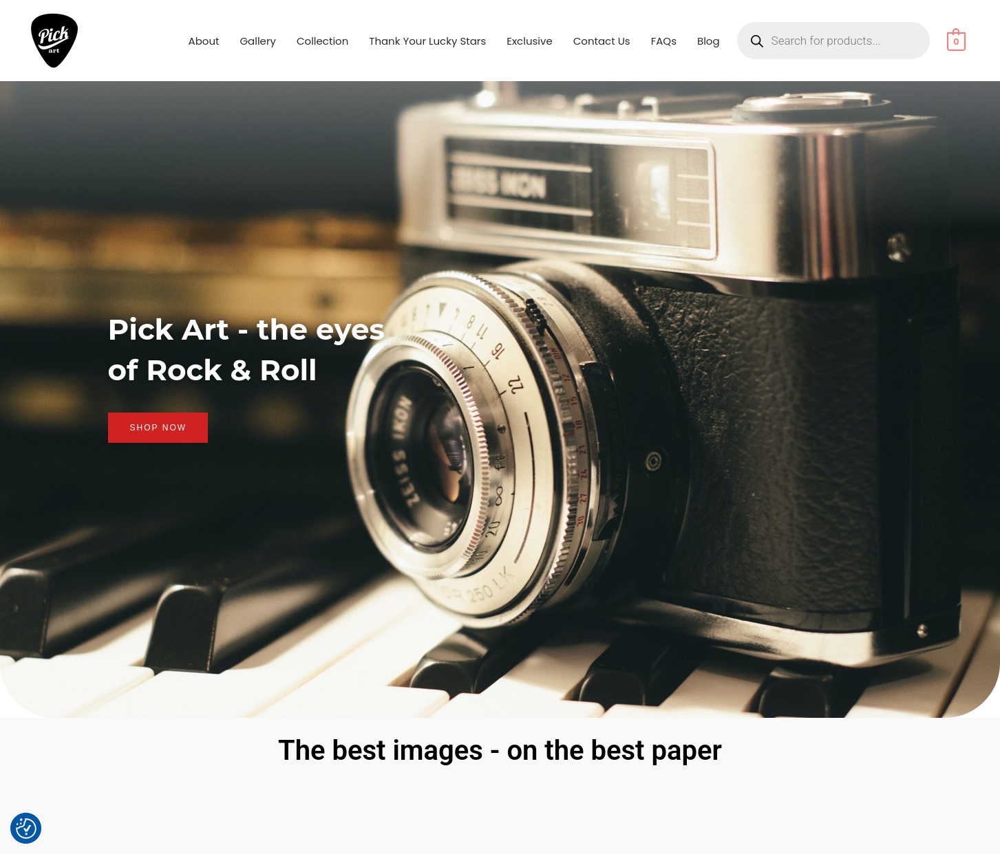
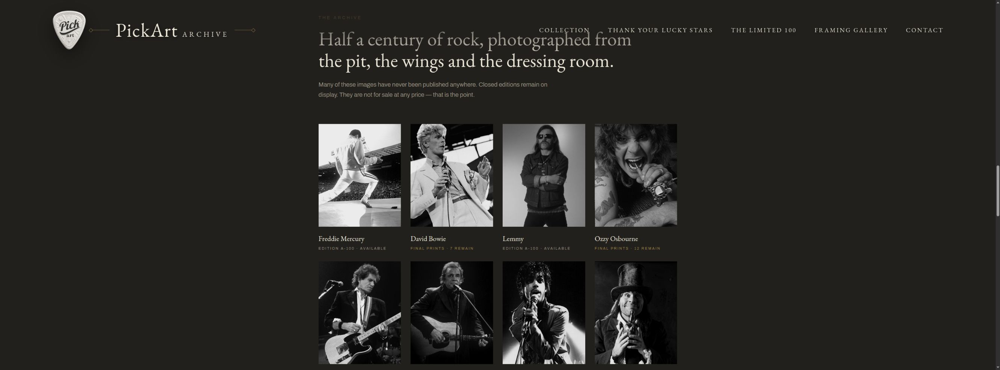
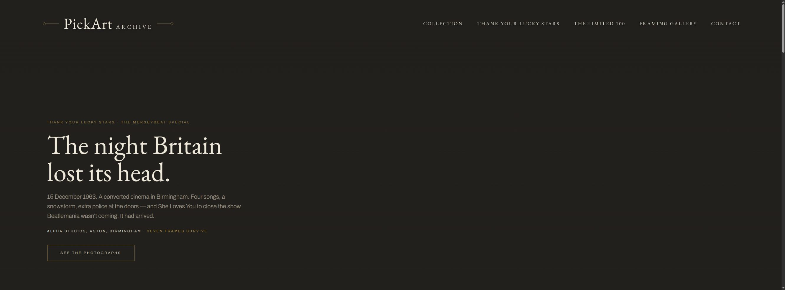
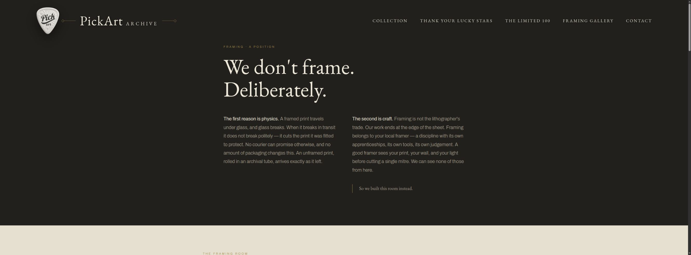

# 03 — Website redesign: from catalogue to collection

I believed PickArt’s website was presenting rare music photographs as ordinary products. The stories and exclusivity were there, but the presentation was not giving visitors enough reason to want a print. I proposed the campaign experiment to test that diagnosis: could we attract an audience, and would the existing shop turn that interest into sales?

The campaign brought substantial traffic, but the owner reported little or no sales uplift. He agreed to a redesign. This phase shows the working proposal I built to make that alternative tangible. [See the campaign experiment](../02-meta-ad-campaign/README.md).

I wrote the existing Thank Your Lucky Stars copy and product stories, supplying them to the owner and his developer as text. I did not design the existing layout. The comparison below shows why the words needed a visual structure that supported them.

## Homepage: from category to object

| Existing shop | Proposed archive presentation |
| --- | --- |
|  |  |
| The opening uses a stock camera image and a broad “eyes of Rock & Roll” invitation. It establishes the subject area, but the first image is not one of the exclusive photographs for sale. | The proposed homepage gives the photographs themselves the space: a curated archive section headed “Half a century of rock, photographed from the pit, the wings and the dressing room.” Consistent image treatment, artist names and edition details make the collection—not generic camera imagery—the focus. |

The design gives the photographs and their archive context prominence. Charcoal, cream and gold, serif display type, generous image space and quieter navigation give the proposal the feeling of a considered archive rather than a general-purpose catalogue.

## Thank Your Lucky Stars: from background to a particular moment

| Existing TYLS page | Proposed TYLS opening |
| --- | --- |
|  |  |
| A large star-field banner and prominent heading introduce a long, uniformly bold block before the product grid. The history and photographer information are present, but the opening gives the reader few visual pauses to distinguish the event, its significance and the collection’s provenance. | The Beatles’ Merseybeat Special becomes a specific entry point: 15 December 1963, Alpha Studios in Aston, Birmingham, four songs and the surviving frames. A short narrative hierarchy connects place, date and event to the photographs. |

The aim is recognition: a visitor who knows and loves this music should feel that the collection shares their interests and understands why these images matter.

## The quiet signals behind a £149 print

I treated the design as a way to answer practical buyer questions, not simply to make pages feel more luxurious.

| Design choice | Intended signal | Buyer question it can help answer |
| --- | --- | --- |
| Large photographs with space around them | Confidence in the image as the object | “Can I see what I am considering?” |
| Restrained palette, serif headlines and editorial hierarchy | A curated archive rather than a crowded commodity listing | “Has this collection been selected and presented with care?” |
| Edition, embossing, certificate and provenance information | Scarcity, authenticity and attention to the print’s history | “What makes this particular print meaningful?” |
| Story before the price-led grid | Cultural context and a reason to value the moment | “Why this photograph, and why this moment?” |
| Aspirational room imagery and framing choices | A sense of ownership, taste and where the work might belong | “How could this live in my space?” |
| Consistent typography, spacing and finishing | Intentionality across the buying experience | “Does the care shown here extend beyond the photograph?” |

The idea is to connect limited-edition music photography with the knowledge, taste and personal attachment that can make someone want to live with a particular image. These design signals are intended, not measured effects.

## Presentation is part of the product

Several existing collection prints are photographed through glass; reflections, banding and the phone/photographer silhouette are visible over the Paul McCartney image. That undermines the premium presentation the photographs deserve. I reprocessed many of the presentation images, and the owner later told me he changed the print process to reflect that improved presentation.

## “We don’t frame. Deliberately.”

Framing is a reasoned service decision, not a missing feature to conceal. Rob stopped offering framed prints after glass was damaged across courier depots. A ready-made frame may also not suit a customer’s wall or taste. I proposed stating the choice positively: sell the unframed print, leave the customer free to choose, and respect local framers’ expertise.

The visualiser lets a visitor choose a print and wall palette, then compare five frame tones, flat or shaped profiles, frame width, and no, window, double, float or raised-float mounts with width and colour. A printable Framer’s Brief carries those choices to a local framer via the browser’s print dialog. It helps someone picture the work at home and communicate a specification while respecting a framer’s judgement.

## Three working proposal pages

This proposal contains three working prototype pages for the owner to review. Other navigation destinations are outside this preview; it is not a launched replacement shop.

| Page | Open the proposal |
| --- | --- |
| Homepage | [PickArt Archive homepage](https://tidyweb.github.io/pickart-web-redesign/pickart_home.html) |
| Thank Your Lucky Stars | [TYLS collection page](https://tidyweb.github.io/pickart-web-redesign/pickart_tyls.html) |
| Framing Gallery | [Framing visualiser page](https://tidyweb.github.io/pickart-web-redesign/pickart_framing.html) |

The [redesign project repository](https://github.com/TidyWeb/pickart-web-redesign) contains the proposal; the [current PickArt shop](https://www.pickart.co.uk/) is separate. The proposed journey brings photograph, story and choices about living with the print into one experience, giving the owner something tangible to discuss before commissioning production.

This work sits within the wider [PickArt project](../README.md).
