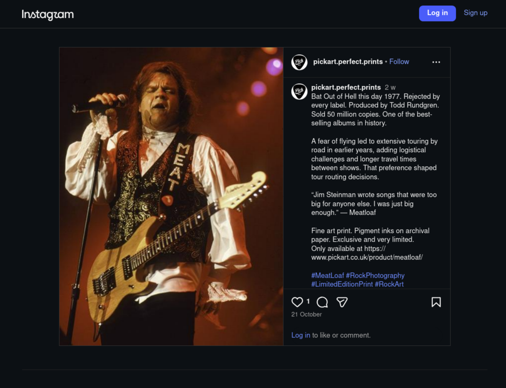
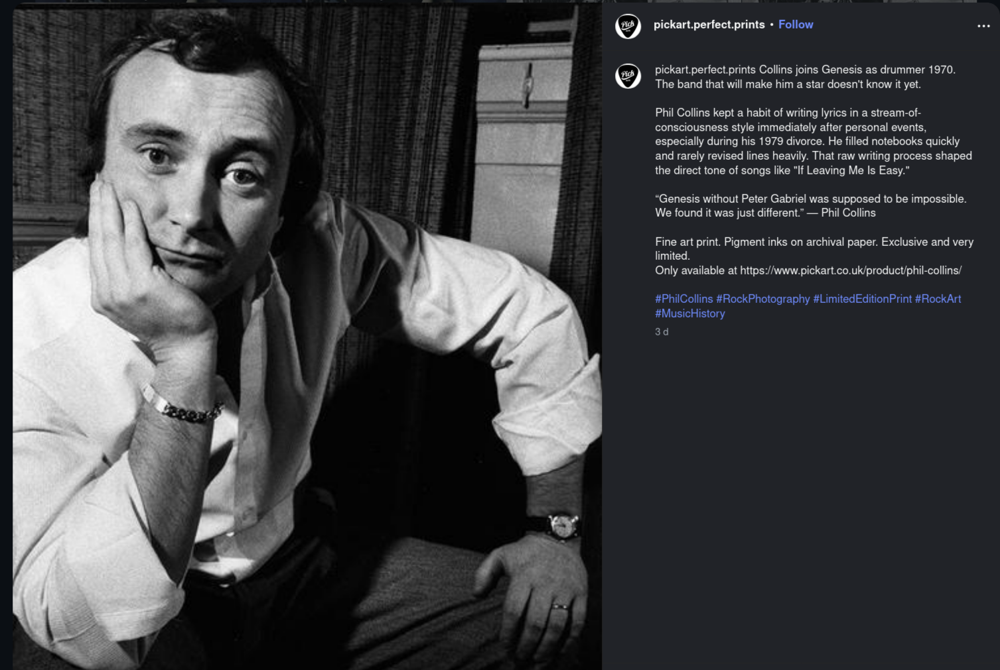

# PickArt Media Bible

**A practical system for turning music stories into social posts.**

PickArt sells high-end, limited-edition music photography. I suggested to the gallery and website's owner that engaging with social media could promote the business, attract visitors and encourage trade. The owner offered me a role managing PickArt's social media. I didn't have time to take on the ongoing role, so I proposed a different solution: build a social-media robot that could post on PickArt's behalf and share interesting material for different audiences.

I wanted the posts to do more than keep a schedule. Each should have a timely or audience-relevant reason to feature an artist and connect their story with the prints. I designed and built a cloud publishing system around that idea. It remains operational.

## Examples of the editorial approach

These published posts show two different angles: an anniversary-led story and a biographical detail.

| Anniversary-led story | Biographical and creative angle |
| --- | --- |
|  |  |
| The date gives the Bat Out of Hell post its timely hook. | The post pairs Collins's Genesis story with a detail about his songwriting process. |

## How selection works

The system checks the event calendar first. Events can include an artist's birthday, date of death, first album release, first hit single or another anniversary. A matching event guides the choice of artist and related content. If no event matches, the system uses an evergreen route to select audience-specific material.

| Route | Content selected |
| --- | --- |
| Matching event | Related event-led artist content |
| No matching event | Evergreen content for the intended audience |

Evergreen material can cover recording techniques, equipment and how songs were made; unusual or amusing facts; personal biography; or décor ideas that connect a print with a room and give its owner a story to share. Different posts can take different angles.

I built Python programs that run on Google Cloud Run and draw on an image library, event calendar and multiple structured content databases. Both selection routes lead to publishing through Publer, which passes posts to Facebook and Instagram. My work included the structured inputs, selection and fallback rules, audience-aware editorial approach, cloud integration and practical operation.

## Operating record

As its builder, on 4 November 2026 I reported **1,288 posts since launch and no failures I had experienced**. This is my operating record, not an independent uptime audit.

## The wider PickArt project

I also worked on a separate [website redesign](https://github.com/TidyWeb/pickart-web-redesign), with a [proposed redesign experience](https://tidyweb.github.io/pickart-web-redesign/pickart_home.html). A separate Meta Ads exploration tested how the existing site responded to paid traffic and informed the redesign work. Paid advertising is distinct from the publishing system.

*The implementation remains private. Screenshots are included as evidence for this case study, not with permission to reuse them. The photography and prints are not claimed as my work.*
