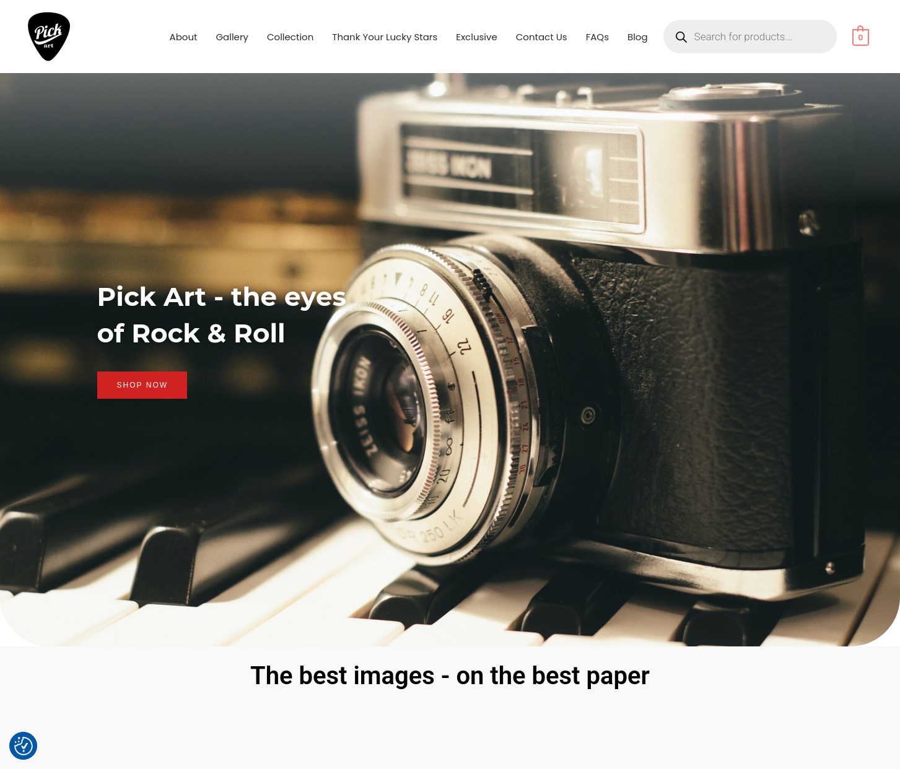
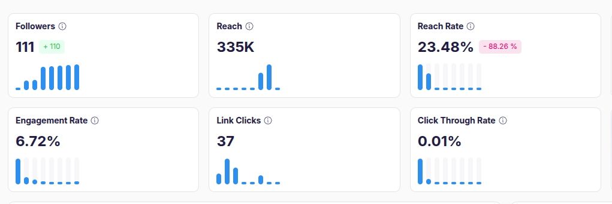

# PickArt Project

*This project follows the progression—from an existing if under-performing website, an operating publishing system, through a bounded campaign experiment, to a proposed redesign. Each phase answers a different question.*

PickArt (pickart.co.uk) wants to be a high-end, music-photography, limited-edition print shop. I know the owner from mutual work with the Birmingham band UB40, and he asked me for my advice regarding his business idea because the website he had paid to have built, had been lolling in the doldrums for 5 years.

I researched what the market for exclusive high end archival prints in this market area was like.  I looked at what other people were doing.  My conclusion was his website was not fit for purpose because it had been built to a standard e-commerce pattern. A template in effect.  This could never work for his offer, so I treated him as a client and I explained it like this.

Consumer goods tend to obey MOSCOW rules:
Let's look at householders.

- **MUST HAVES:** A refrigerator, a cooker.
- **SHOULD HAVES:** A dish-washer, a laundry dryer.
- **COULD HAVES:** A fine vase, or a piece of fine art for the wall.
- **WON'T HAVE:** Leaky roofs etc.

I persuaded him that his offer fell into the 'Could Have' category.  It was a luxury buy.  It could not be advertised as if it was a refrigerator.  It had to differentiate itself as, exclusive, limited, rare, very high quality, a way to display taste, and that every print had to be accompanied by a story.  The story is vital because people who have nice things that people tend to comment on when invited into their homes, love telling you all about them.  It gives unlimited extra pleasure on top of the simple joy of ownership.  
I know this from personal experience as the client loves doing this very thing.

The client understood my logic, and agreed, but he was wedded to the notion that he had paid a considerable sum for his website and he thought it looked good, so my inital suggestion to redesign the entire site from the perspective of a curated rare collectors items was denied.

I suggested he engage in social media.  He wanted me to do that for him, but I could not commit the time required, so I said I would build him a social media posting robot, that would post automatically on his websites behalf.  He did not think it could be done, so I explained my plan, how it would work, and the minimal cost it would take.  He agreed so I built the Media Bible project.

*Publer overview captured on 5 November 2026: since the Media Bible robot began posting, the account gained 110 followers and reached 335K people, with a 6.72% engagement rate.*

The robot started in May 2026, and has posted up to 18 times per day across Meta platforms, establishing a brand identity.  It has not failed yet.  You can read about the process in  [01 — Media Bible robot](01-media-bible-robot/README.md).

While acknowledging the robot was working, his website was still struggling to close sales.  I repeated my analysis that the website was wrong for what he was offering.  Again he disagreed, it looked fine to him.  So knowing him well enought to estimate the likely success of my proposal - I proposed to him a wager.

I would build and implement a Meta Ad campaign.  We would spend £250 (and set a limit) on an array of 12 ads - that I would make and he could review, approve or deny.  We quickly agreed on the ads for the campaign.  He wanted a focus on his Beatles archive from December 1963 because they are exclusive to Pick Art - and I agreed.  If traffic to his website rose significantly but sales did not increase in a similar proportion - he would agree to the complete redesign - if it rose and sales rose in line - I would refund the ad costs - and if site traffic did not rise - my ad campaign did not work and I would again cover the campaign costs.  Of course, he said yes.

The Meta Ad campaign was a stunning success - you can read about the details in the relevant section.  Suffice to say, the firm that built and hosts his website phoned him to ask what was going on, as they had to move the site to a new server such was the demand.  His sales however remained flat.
You can read about the Meta ad campaign here: [02 — Meta ad campaign](02-meta-ad-campaign/README.md)

So that leaves the complete and total website re-design upon which I am embarked now.  I made a mock-up webpage with three operational pages that display the key fundamentals of my approach.

- **Exclusivity:** Present the prints as rare, high-quality pieces with limited availability, well away from the look of a white-goods site.
- **Beatles focus:** Give one page to PickArt's exclusive archive from the Beatles' December 1963 *Thank Your Lucky Stars* appearance, with thousands of remarkable historical images.
- **Framing gallery:** Let visitors view a chosen print in different frame and matting styles, then print a specification of their preferred option.

Together, these three pages turn the argument into something the owner can try. They show how the archive’s rarity, the stories behind the photographs and the experience of choosing a print could work together—giving visitors something they would value owning and talking about. The prototype provides a practical basis for feedback before building the full shop.

The reasoning behind this three-page prototype is outlined in [03 — Website redesign](03-website-redesign/README.md).

| Phase | Question | Outcome and status |
| --- | --- | --- |
| [01 — Media Bible robot](01-media-bible-robot/README.md) | Could a system publish timely, audience-relevant music stories consistently? | Operational; 1,288 posts since regular publishing began in May 2026, with zero failures as of 4 November 2026. |
| [02 — Meta ad campaign](02-meta-ad-campaign/README.md) | How would the existing shop respond to an exploratory paid campaign, and what could the journey reveal? | Completed experiment; it brought substantial traffic, while the owner reported little to no sales uplift. It informed the next phase. |
| [03 — Website redesign](03-website-redesign/README.md) | How might the shop better express the archive's stories and help visitors decide to buy? | A proposed experience is available as a mock-up; redesign delivery and testing remain planned work. |

*The campaign tested the existing website—not the proposed redesign. The captured results cover 13 September–31 October 2026. Follow-up checks highlighted outdated or broken ecommerce components, informing the redesign phase regarding maintainability.*

The robot's implementation remains private. This repository presents the public case study and selected evidence; it does not include private application code or operational data.
